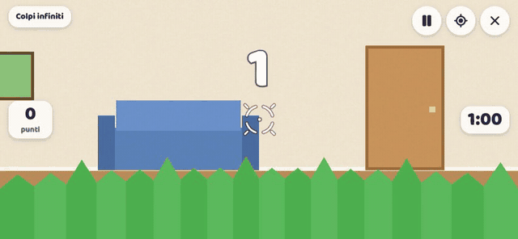
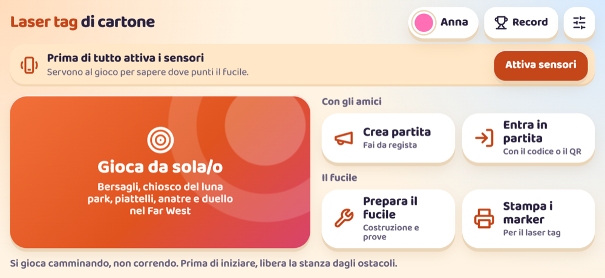
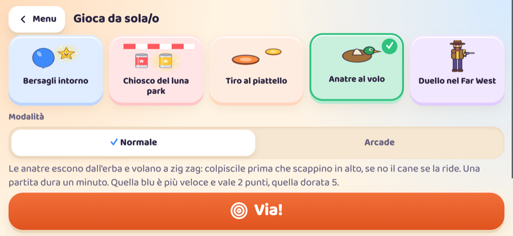

# Laser tag di cartone

[English](README.md) · **Italiano**

Giochi di tiro in realtà aumentata da fare in casa. Il telefono si monta su un fucile di cartone fatto a mano: la fotocamera inquadra la stanza, al centro dello schermo c'è il mirino e il grilletto è una leva di cartone che tocca lo schermo.

È una web app: non serve installare niente dagli store e non servono account. È in italiano e in inglese: sceglie da sola la lingua del telefono, e si può cambiare nelle Impostazioni. È nata per due bambine di 9 e 10 anni: un adulto costruisce i fucili e fa da regista.



Il [video completo](docs/video/demo.mp4) (80 secondi) mostra il menu, una partita di laser tag tra due telefoni, le anatre al volo, il chiosco del luna park e il duello nel Far West. È registrato sul computer, con una stanza disegnata e un'amica di cartone al posto della fotocamera. Anche i personaggi sono sagome di cartone.



## Cosa si può fare

**Da sole o da soli**, anche senza rete:

- **Bersagli intorno**: palloncini, stelle, mostriciattoli, lattine o zombi buffi compaiono nella stanza, davanti, di lato e dietro. Il gattino col cuore non si colpisce.
- **Chiosco del luna park**: tre file di bersagli che scorrono, 20 colpi e un premio alla fine.
- **Tiro al piattello**: i piattelli volano ad arco da un lato all'altro e vanno presi prima che ricadano.
- **Anatre al volo**: come Duck Hunt, le anatre escono dall'erba e volano a zig zag. Se scappano, il cane se la ride.
- **Duello nel Far West**: al suono della campana spunta il bandito Baffone, e va colpito prima che dalla sua rivoltella giocattolo esca la bandierina BANG. In Difficile passa anche la signora Rosina, che non va colpita.
- **Arcade**, per tutti i giochi: si perde un colpo solo quando si sbaglia e si va avanti finché ne restano.

**In gruppo**, con un telefono che fa da regista:

- **Laser tag**: ci si colpisce a vicenda mirando ai marker stampati sul petto e sulla schiena. Tutti contro tutti o a squadre, con i cuori, il "fuori gioco" e il rientro.
- **Sfida a bersagli**: la stessa sequenza di bersagli per tutti e la classifica in diretta.
- **Bersagli condivisi**: gli stessi bersagli nello stesso punto della stanza per tutti, e chi colpisce per primo prende il punto.

Il regista crea la partita, mostra un codice di 4 lettere e un QR, sceglie il gioco e fa partire tutti insieme. Può giocare anche lui o fare solo da arbitro, per esempio con il telefono di un genitore. Le partite durano 3, 5 o 10 minuti.



## Costruire il fucile

Il progetto del fucile si scarica anche dall'app, nella schermata **Prepara il fucile**.

| File | Cosa contiene |
|---|---|
| [`docs/laser-tag-fucile-template.pdf`](docs/laser-tag-fucile-template.pdf) | Le parti da stampare su A4 al 100%, da ricalcare sul cartone, e i passaggi di montaggio ([in inglese](docs/cardboard-blaster-template.pdf)) |
| [`docs/fucile-3d.html`](docs/fucile-3d.html) | Modello 3D interattivo, si apre nel browser |
| [`docs/MATERIALI.md`](docs/MATERIALI.md) | Lista dei materiali per tre fucili ([in inglese](docs/MATERIALS.md)) |
| [`docs/FUCILE.md`](docs/FUCILE.md) | Le cose del fucile che contano per il gioco ([in inglese](docs/BLASTER.md)) |

Il fucile tiene telefoni fino a 175 x 82 x 13 mm con la cover. Il taglierino e la colla a caldo li usa un adulto.

## Privacy e sicurezza

- Le immagini della fotocamera non lasciano mai il telefono: i marker si riconoscono sul telefono stesso, in un Web Worker.
- Al server arrivano solo eventi di gioco, per esempio "colpito il marker 3". Non ci sono account e non si salva niente oltre la partita. La stanza si cancella da sola 30 minuti dopo che è rimasta vuota.
- I record dei giochi da soli restano sul telefono.
- Si gioca camminando, non correndo: il gioco lo ricorda se sente scossoni. Il linguaggio è non violento: "colpito" e "fuori gioco", mai altro.

## Telefoni

Provato su iPhone 17 Pro, iPhone 14 Pro, Xiaomi Redmi A5 (bussola senza giroscopio) e Samsung Galaxy A02s come regista. Per i giochi a bersagli serve un telefono che sappia quando ti giri (giroscopio, o almeno la bussola). Il laser tag usa solo la fotocamera e funziona su tutti.

## Provarlo sul tuo computer

Serve Node 22 o superiore.

```sh
npm install
npm run dev        # server HTTPS locale, raggiungibile anche dalla rete Wi-Fi
npm run check      # controllo della logica (orientamento, bersagli, record, regole del laser tag)
```

`npm run dev` fa girare in locale anche il server delle partite (Worker e Durable Object, con il plugin Cloudflare per Vite).

Fotocamera e sensori funzionano solo in HTTPS. Per aprire il gioco dal telefono:

1. **Tunnel HTTPS (consigliato)**: installa una volta `cloudflared` (`brew install cloudflared`), poi con `npm run dev` acceso:
   ```sh
   cloudflared tunnel --url https://localhost:5173 --no-tls-verify
   ```
   Apri sul telefono l'indirizzo `https://...trycloudflare.com` che compare. Non serve un account.
2. **Stessa rete Wi-Fi**: apri l'indirizzo `Network` stampato da `npm run dev` e accetta l'avviso sul certificato.

Su iPhone conviene aggiungerlo alla schermata Home (Condividi, poi Aggiungi alla schermata Home): così si gioca a schermo intero.

## Pubblicarlo gratis su Cloudflare

Serve un account Cloudflare gratuito.

```sh
npx wrangler login   # una volta sola
npm run deploy       # build e pubblicazione
```

Il gioco va su `https://laser-tag-cartone.<tuo-sottodominio>.workers.dev`. Il Durable Object usa l'archivio SQLite, l'unico disponibile nel piano gratuito. Pubblicare una nuova versione scollega chi sta giocando in quel momento.

## Come è fatto

- **Frontend**: Vite e TypeScript senza framework, Three.js per gli zombi in 3D, js-aruco2 per i marker, PWA che funziona anche offline.
- **Server**: un Cloudflare Worker con un Durable Object per ogni partita, WebSocket con ibernazione. Le regole del laser tag stanno in `src/rules.ts`, condivise tra telefono e server, e il server ha sempre l'ultima parola.
- **Nessun database** e nessun account.

| Percorso | Cosa contiene |
|---|---|
| `src/` | Il gioco: menu, giochi, sensori, riconoscimento dei marker, lobby |
| `worker/` | Il server delle partite |
| `docs/PROMPT.md` | La specifica completa da cui è nato il progetto |
| `CLAUDE.md` | Le istruzioni per Claude Code |

Il gioco è stato scritto con [Claude Code](https://claude.com/claude-code), partendo da `docs/PROMPT.md` e procedendo una milestone alla volta, provando ogni passo sui telefoni veri.

## Licenza

- Il **codice** del gioco ha la licenza [MIT](LICENSE): puoi riusarlo liberamente, citando l'origine.
- Il **fucile e i documenti** in `docs/` (template PDF, modello 3D, materiali e guide) hanno la licenza [CC BY-NC-SA 4.0](docs/LICENSE.md): puoi costruirlo, modificarlo e condividerlo citando il progetto, ma non venderlo.
